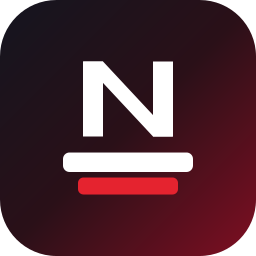

<p align="center">
  
</p>

<h1 align="center">MultiSub</h1>

<p align="center">
  在 Mac 的 Safari 看 Netflix 時，同時顯示兩種語言的字幕。<br>
  可以直接用 Netflix 官方字幕、用 AI 翻譯，或只在難字後面標上意思。
</p>

<p align="center">
  <a href="https://snch1211.github.io/multisub/">官方網站</a> ·
  <a href="https://github.com/snch1211/multisub/releases">下載 DMG</a> ·
  <a href="PRIVACY.md">隱私權政策</a> ·
  <a href="docs/ARCHITECTURE.md">架構說明</a>
</p>

> MultiSub 是非官方的社群開源專案，與 Netflix 沒有任何關聯，也未經 Netflix 背書或贊助。

---

## 三種字幕模式

預設是 Netflix 雙語字幕，不用設定 AI，打開 Netflix 播放就有。想換模式，點 Safari 工具列的 MultiSub 選單切換，選過就會記住。

| 模式 | 畫面上看到的 | 需要 AI 嗎 |
|---|---|---|
| **Netflix 雙語字幕** | 原文字幕，加上 Netflix 官方提供的第二語言字幕 | 不用 |
| **AI 翻譯雙語字幕** | 原文字幕，加上 AI 翻譯的第二語言字幕 | 要 |
| **生字標註** | 只有原文字幕，較難的單字和片語後面加上簡短的意思 | 要 |

**Netflix 雙語字幕**直接拿 Netflix 自己的字幕軌，兩種語言各照各的時間軸顯示，不會因為斷句不同而對不齊。Netflix 沒有你要的語言時，選單會建議改用 AI 翻譯。

**AI 翻譯**會參考 Netflix 官方字幕裡的人名和專有名詞，讓譯名跟官方一致，其他部分照口語重新翻。

**生字標註**是給學語言的人用的。依你設定的程度（初級 A2 到高級 C1）挑出可能不懂的字，每個字後面只加幾個字的意思，例如「We need to come up with 想出 a plan before dawn.」。意思會對照同一句的 Netflix 官方翻譯，挑符合這一幕的用法，不會硬翻單字讓你停下來想。同一個字一集最多標三次，看熟了就不再出現。

另外還有：

- **生詞本**：在選單按「整理本集單字」，App 會在背景把整集英文單字依 CEFR 分級整理，附解釋、翻譯和例句。整理進度在選單和 App 的「生詞本」都看得到，可以邊整理邊看
- **字幕樣式**：字級、位置、顏色、外框、字型都能調，也能直接在影片上拖曳位置
- **從目前播放的地方開始處理**：跳到後面時，會優先處理你正在看的段落
- **快取**：處理過的集數會保存，重看不必再等

## AI 引擎

AI 翻譯和生字標註需要一個 AI 引擎，兩種擇一：

**自己的 API Key（推薦）**：不用下載模型，速度最快。支援下列服務，也可以填任何 OpenAI 相容的網址（例如本機的 LM Studio 或 Ollama）。

| 服務 | 預設模型 | 取得 API Key |
|---|---|---|
| Anthropic | `claude-haiku-5-5` | https://platform.claude.com/settings/keys |
| OpenAI | `gpt-6-luna` | https://platform.openai.com/api-keys |
| OpenRouter | `anthropic/claude-haiku-5.5` | https://openrouter.ai/settings/keys |
| Google Gemini | `gemini-3.1-flash-lite` | https://aistudio.google.com/apikey |

預設都選各家最快、最便宜的模型，看劇時字幕才跟得上。想要更好的翻譯品質，可以在模型選單換成較大的模型，或按「載入完整清單」挑其他模型。API Key 存在 macOS 鑰匙圈，不會出現在延伸功能裡。

**本機模型**：免費、完全離線，字幕不會離開你的 Mac。第一次使用要在 App 裡下載 Gemma 模型（約 3–5 GB），建議 16 GB 以上記憶體。

## 安裝

**Mac App Store**：搜尋「MultiSub」安裝（審核中）。

**GitHub**：到 [Releases](https://github.com/snch1211/multisub/releases) 下載 `MultiSub-<版本>.dmg`，把 MultiSub 拖進「應用程式」。這個版本沒有經過 Apple 公證，第一次開啟時請對 App 按右鍵 →「打開」，或到「系統設定 › 隱私權與安全性」按「仍要打開」。

### 開始使用

打開 MultiSub，「開始使用」頁面只有兩個步驟：

1. **啟用 Safari 延伸功能**：按「打開 Safari 設定」，勾選 MultiSub。第一次在 netflix.com 用的時候，Safari 會詢問網站權限，選「一律允許」（選「允許一天」隔天就會失效）。
2. **打開 Netflix**：按「在 Safari 打開 Netflix」，播放任何影片就會出現 Netflix 雙語字幕。第二語言預設跟著系統語言。

想用 AI 翻譯或生字標註，展開同一頁的「字幕模式與語言」，或直接在 Safari 工具列的選單切換模式，再貼上 API Key 或下載本機模型。

設定一次就會記住。App 和 Safari 工具列的選單共用同一份設定，在哪邊改都可以。

### 系統需求

- 搭載 Apple 晶片的 Mac，macOS 15 以上
- Safari 與 Netflix 訂閱
- 本機模型（選用）：建議 16 GB 以上記憶體、約 3–5 GB 磁碟空間

## 疑難排解

**字幕沒有出現**

- 先點 Safari 工具列的 MultiSub 圖示。選單會告訴你缺什麼：如果顯示「需要重新整理 Netflix 分頁」，按「重新整理」。如果顯示「還沒有 Netflix 的存取權限」，按「允許存取」。
- 剛安裝或更新延伸功能後，已經開著的 Netflix 分頁要重新整理一次才會載入。
- Safari 的網站權限如果選了「允許一天」，隔天就會失效。到「Safari › 設定 › 延伸功能 › MultiSub」把 netflix.com 改成「允許」。

**AI 翻譯或標註出現錯誤**

選單會顯示原因。看到「API Key 無效或已過期」，請重新貼上。看到「額度或請求次數到上限了」，請到服務商的網站檢查餘額和用量。看到「本機模型還沒下載完」，打開 App 的「一般設定」下載。

## 從原始碼建置

需要 Xcode 27 以上。延伸功能是純 JavaScript（不需要 npm），主程式是 SwiftUI。

```bash
git clone https://github.com/snch1211/multisub.git
cd multisub/MultiSub
cp Local.xcconfig.example Local.xcconfig
```

編輯 `Local.xcconfig`，填入自己的 Team ID 和一個自己的 Bundle ID（Bundle ID 在 Apple 是全球唯一的，不能沿用別人的）。免費的 Personal Team 就可以在自己的 Mac 上執行：

```
DEVELOPMENT_TEAM = ABCDE12345
MULTISUB_BUNDLE_ID = com.yourname.multisub
```

建置並安裝到「應用程式」：

```bash
./deploy.sh
```

裝好後到 Safari 設定啟用延伸功能。之後每次改完程式重新執行 `./deploy.sh`，再到 Safari 設定把 MultiSub 取消勾選再勾回來，並重新整理 Netflix 分頁。

其他指令：

```bash
./deploy.sh --release && ./scripts/make-dmg.sh   # 打包 GitHub Releases 用的 DMG
./scripts/archive-appstore.sh --upload            # 上傳 Mac App Store 版本
```

App Store 版用 `MULTISUB_DISTRIBUTION=appstore` 建置：沒有 GitHub 自動更新，改用 App Store 專用的權限設定和圖示。

### 專案結構

```
extension/            Safari 延伸功能（純 JS，Manifest V3）
  inject.js           在網頁裡攔截 Netflix 的字幕清單
  content.js          三種模式、字幕對齊、畫面上的字幕
  background.js       翻譯／標註工作排程、快取
  popup.*             工具列選單
  shared.js           共用常數與工具函式
MultiSub/
  Shared/             App 與延伸功能共用：AI 引擎、提示詞、設定、鑰匙圈
  MultiSub Extension/ 接收延伸功能訊息的原生程式
  MultiSub/UI/        主程式畫面（SwiftUI）
docs/ARCHITECTURE.md  模式、訊息格式、設定同步的完整說明
```

各部分怎麼溝通、為什麼這樣設計，寫在 [docs/ARCHITECTURE.md](docs/ARCHITECTURE.md)。

## 隱私

沒有帳號、不收集任何使用資料。Netflix 雙語字幕和本機模型模式下，字幕不會離開你的 Mac。使用雲端 AI 時，字幕從你的 Mac 直接送到你自己選的服務，開始前會先徵求同意。詳細內容見 [PRIVACY.md](PRIVACY.md)。

## 授權

程式碼採用 [MIT License](LICENSE)。第三方套件與詞表的授權見 [THIRD-PARTY-NOTICES.md](THIRD-PARTY-NOTICES.md)，其中 CEFR 詞表 C1/C2 部分為 CC BY-SA 4.0，只適用於該資料檔。

MultiSub 由 [snch1211](https://github.com/snch1211) 開發，三種模式、BYOK 與 App Store 版本由 [ncchen99](https://github.com/ncchen99) 協助維護。

"Netflix" 是 Netflix, Inc. 的商標，本專案只為說明用途提及，沒有使用任何 Netflix 標誌。
