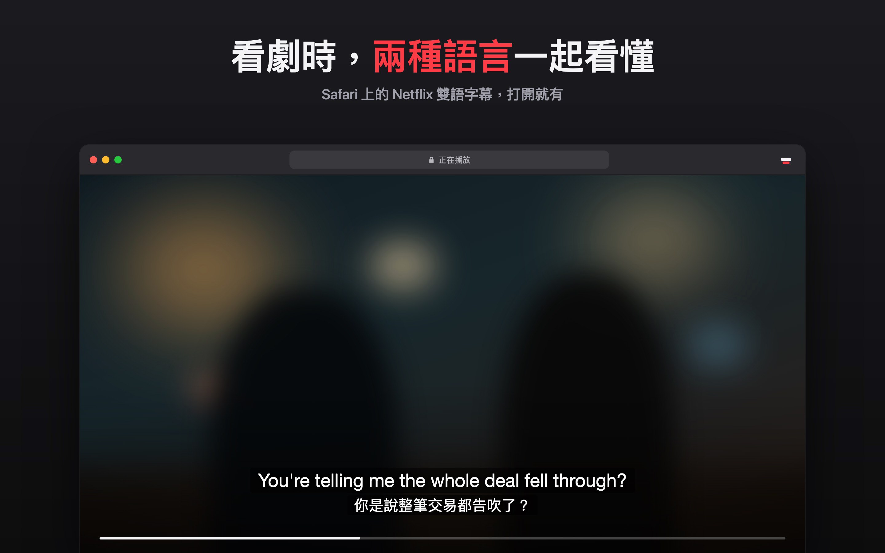
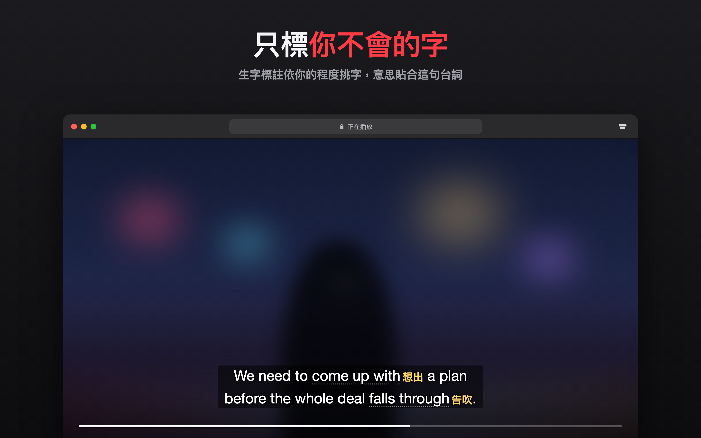
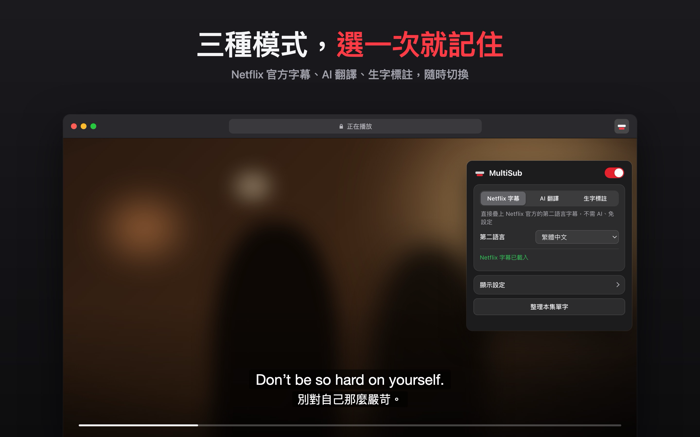
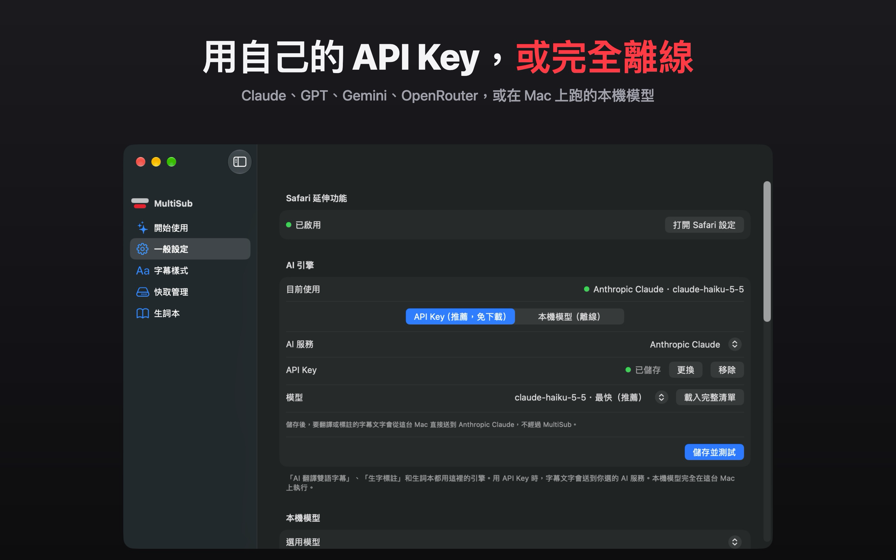
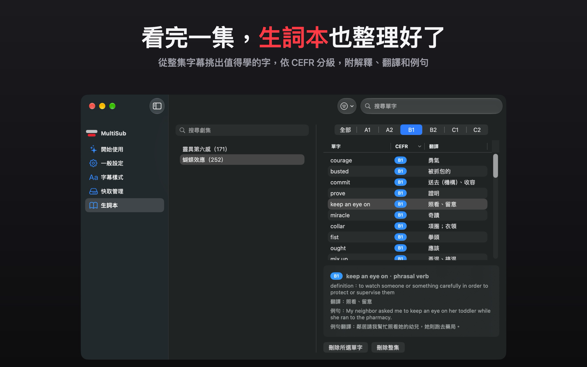

<p align="center">
  
</p>

<h1 align="center">MultiSub</h1>

<p align="center">
  在 Mac 的 Safari 看 Netflix 時，同時顯示兩種語言的字幕。<br>
  用 Netflix 官方字幕、AI 翻譯，或只在難字後面標上意思。
</p>

<p align="center">
  <a href="https://github.com/ncchen99/Multisub/releases/latest"></a>
  
  
  <a href="LICENSE"></a>
  <a href="https://deepwiki.com/snch1211/multisub"></a>
</p>

<p align="center">
  <a href="https://snch1211.github.io/multisub/">官方網站</a> ·
  <a href="https://github.com/ncchen99/Multisub/releases/latest">下載 DMG</a> ·
  <a href="PRIVACY.md">隱私權政策</a>
</p>

<p align="center">
  
</p>

> MultiSub 是非官方的社群開源專案，與 Netflix 沒有任何關聯，也未經 Netflix 背書或贊助。

## 功能

| 模式 | 畫面上看到的 | 需要 AI |
|---|---|---|
| **Netflix 雙語字幕**（預設） | 原文字幕，加上 Netflix 官方的第二語言字幕 | 不用 |
| **AI 翻譯雙語字幕** | 原文字幕，加上 AI 翻譯的第二語言字幕，支援 12 種語言 | 要 |
| **生字標註** | 只留原文字幕，依你的程度（A2–C1）在難字後面加上簡短的意思 | 要 |

模式在 Safari 工具列的 MultiSub 選單切換，選過就會記住。另外還有：

- **生詞本**：在背景把整集英文單字依 CEFR 分級整理，附解釋、翻譯和例句
- **字幕樣式**：字級、顏色、外框、字型都能調，位置可以直接在影片上拖曳
- **快取**：處理過的集數會保存，重看不用再等

<table>
  <tr>
    <td></td>
    <td></td>
  </tr>
  <tr>
    <td></td>
    <td></td>
  </tr>
</table>

## 安裝

- **Mac App Store**：審核中，通過後會放上連結。
- **Homebrew**：

  ```bash
  brew install --cask ncchen99/multisub/multisub
  ```

- **GitHub Releases**：下載 [`MultiSub-<版本>.dmg`](https://github.com/ncchen99/Multisub/releases/latest)，把 MultiSub 拖進「應用程式」。DMG 已經過 Apple 公證，直接打開就好。

### 系統需求

- 搭載 Apple 晶片的 Mac，macOS 15 以上
- Safari 與 Netflix 訂閱
- 本機模型（選用）：建議 16 GB 以上記憶體、約 3–5 GB 磁碟空間

## 開始使用

1. 打開 MultiSub，按「打開 Safari 設定」，勾選 MultiSub 延伸功能。第一次在 netflix.com 使用時，Safari 會詢問網站權限，請選「永遠允許」。
2. 按「在 Safari 打開 Netflix」，播放任何影片就會出現雙語字幕。第二語言預設跟著系統語言。

想用 AI 翻譯或生字標註，在 App 裡設定 AI 引擎，兩種擇一：

**自己的 API Key**：不用下載模型，速度最快。Key 存在 macOS 鑰匙圈。也可以填任何 OpenAI 相容的網址，例如本機的 LM Studio 或 Ollama。

| 服務 | 預設模型 |
|---|---|
| [Anthropic](https://platform.claude.com/settings/keys) | `claude-haiku-5-5` |
| [OpenAI](https://platform.openai.com/api-keys) | `gpt-6-luna` |
| [OpenRouter](https://openrouter.ai/settings/keys) | `anthropic/claude-haiku-5.5` |
| [Google Gemini](https://aistudio.google.com/apikey) | `gemini-3.1-flash-lite` |

**本機模型**：免費、完全離線，字幕不會離開你的 Mac。第一次使用要在 App 裡下載 Gemma 模型（約 3–5 GB）。

## 疑難排解

字幕沒出現或 AI 出錯時，先點 Safari 工具列的 MultiSub 圖示，選單會說明缺什麼、該按哪裡。常見的情況：

- 剛安裝或更新延伸功能後，已經開著的 Netflix 分頁要重新整理一次。
- 網站權限選了「允許一天」，隔天就會失效。到「Safari › 設定 › 延伸功能 › MultiSub」把 netflix.com 改成「允許」。
- 看到「API Key 無效或已過期」，到 App 的「一般設定」重新貼上。

其他問題請到 [Issues](https://github.com/snch1211/multisub/issues) 回報。

## 從原始碼建置

需要 Xcode 27 以上。延伸功能是純 JavaScript，不需要 npm，主程式是 SwiftUI。

```bash
git clone https://github.com/ncchen99/Multisub.git
cd Multisub/MultiSub
cp Local.xcconfig.example Local.xcconfig
```

在 `Local.xcconfig` 填入自己的 `DEVELOPMENT_TEAM` 和 `MULTISUB_BUNDLE_ID`（免費的 Personal Team 就可以），再回到專案根目錄建置並安裝到「應用程式」：

```bash
./deploy.sh
```

執行測試（只需要 Node）：

```bash
./tests/run.sh
```

程式怎麼分工，寫在 [docs/ARCHITECTURE.md](docs/ARCHITECTURE.md)。發版（DMG 公證、Homebrew、App Store）的步驟寫在 [docs/RELEASING.md](docs/RELEASING.md)。

## 隱私

沒有帳號，不收集任何使用資料。Netflix 雙語字幕和本機模型模式下，字幕不會離開你的 Mac。使用雲端 AI 時，字幕從你的 Mac 直接送到你自己選的服務，開始前會先徵求同意。詳見 [PRIVACY.md](PRIVACY.md)。

## 授權

程式碼採用 [MIT License](LICENSE)。第三方套件與詞表的授權見 [THIRD-PARTY-NOTICES.md](THIRD-PARTY-NOTICES.md)，其中 CEFR 詞表 C1/C2 部分為 CC BY-SA 4.0，只適用於該資料檔。

MultiSub 由 [snch1211](https://github.com/snch1211) 開發，三種模式、BYOK 與 App Store 版本由 [ncchen99](https://github.com/ncchen99) 協助維護。Netflix 是 Netflix, Inc. 的商標，本專案只為說明用途提及。
